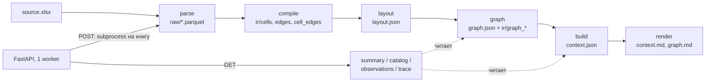
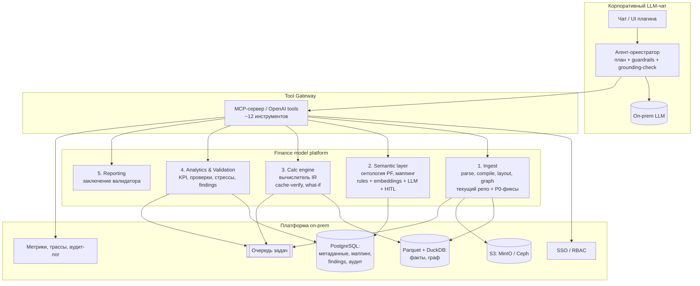

# Валидация finance-context-builder и целевая архитектура для финансового анализа в LLM-чате

Дата: 2026-10-16. Ревизия: `9dd93ed` (main, после PR #66). Документ — результат ревью кода, прогона на корпусе и синтетических моделях.

Цель продукта: плагин корпоративного LLM-чата банка (on-prem). Плагин разбирает Excel-модели cash-flow любой сложности и с помощью инструментов и LLM проводит полноценный финансовый анализ и валидацию.

---

## 1. Резюме

**Вердикт.** Как ingest-ядро («Excel → структурированный IR») репозиторий — хорошая основа, его стоит сохранить. Для финансового анализа и валидации он закрывает только первый шаг: модель **читается**. Слоёв **понимания** (что такое CFADS в этой книге), **расчёта** (пересчёт, what-if), **проверки** (KPI, целостность, ковенанты) и **диалога** (инструменты для LLM) нет.

**Что подтверждено.**

- Пайплайн детерминированный и read-only. Код: 13k строк. Тесты: 322 (319 проходят, 3 e2e пропускаются). Ruff без замечаний.
- На двух моделях корпуса значения привязаны к правильным периодам: сверено 30+ строк, расхождений 0.
- Независимый пересчёт по извлечённым рядам совпал с моделью до 1e-12: Project IRR 17,97% и Equity IRR 22,96% (Packt), min и avg DSCR 1,4485 и 1,8617 (RVI). Значит, извлечённые ряды годятся как основа для детерминированной аналитики.

**Блокеры для целевого сценария (банк в РФ, модели любой сложности).**

1. **Ссылки на листы с кириллическими именами не парсятся.** Excel хранит их без кавычек (`=Допущения!C4`). На русской синтетической модели в таком виде не разобрано 84 из 187 формул. Межлистовых связей становится 0 вместо 96, у строк пропадают формулы.
2. **Не распознаются рублёвые единицы.** «тыс. руб.» и «млн руб.» не считаются единицами, поэтому `normalized_values` ошибаются в 10³–10⁶ раз. Числовой формат `[$₽-419]` определяется как **USD**.
3. **Нет семантики.** Маппинг удалён в PR #66, и инструмент не знает, где в модели CFADS, обслуживание долга или DSCR. Поиск — только по подстроке подписи.
4. **Нет аналитики и валидации.**
   - KPI и проверки не реализованы.
   - Собственные check-строки модели и «Covenant breach» помечаются `excluded`.
   - Типовые ошибки моделирования не ловятся. Пример: SUM без последнего периода.
5. **Нет пересчёта.**
   - What-if невозможен.
   - Признаки устаревшего кэша не обнаруживаются: `calcMode=manual`, `fullCalcOnLoad` (стоит у обеих книг корпуса), формулы без кэша.
   - `#DIV/0!` получает статус `cached`.
6. **Нет контракта инструментов для LLM.** Нет ни MCP, ни function calling. Размер ответов API не ограничен: trace — до ~274k токенов, catalog — ~46k.
7. **Не готово к on-prem в банке.** Нет аутентификации, разделения пользователей, аудита и очереди задач.
8. **Не масштабируется на большие книги.** Расход памяти — около 10 КБ на формульную ячейку, то есть 10–50+ ГБ на книгу с 1–5 млн формул.

**Рекомендация.** Сохранить репозиторий как ingest-ядро, исправив P0 из раздела 9. Вокруг ядра построить пять слоёв: Semantic, Calc, Analytics & Validation, Agent Tools (MCP) и Platform. Главный принцип: **LLM планирует и объясняет, а каждое число приходит из детерминированного инструмента со ссылкой на ячейку**.

---

## 2. Что и как проверялось

| Что | Как |
| --- | --- |
| Код и документация | Все модули `src/finance_context`, docs RU/EN, история (134 коммита, 14.09–16.10.2026), удалённый слой маппинга (`83d1ed2`, ~14,8k строк) |
| Корпус | `packt-project-finance`: 10 листов, 4 088 ячеек, 2 973 формулы, MIT.<br>`rvi-project-finance`: 3 листа, 11 374 ячейки, 10 219 формул, CC-BY-NC-SA.<br>`three-statement` не скачивается: URL отдаёт 404, sha256 не задан |
| Сверка с исходником | openpyxl, сравнение подписей, значений и периодов. Покрытие: числовые и формульные ячейки исходника против ячеек в `context.json` |
| Синтетика | Русская PF-модель: тыс. руб., «1 кв. 2025», флаги строительства и эксплуатации, ковенант DSCR 1,2 с нарушением.<br>Мутант с типовыми ошибками.<br>Вариант с ссылками на кириллические листы без кавычек.<br>Форматы периодов, скрытые строки и листы, транспонированные таблицы.<br>Нагрузочные книги на 60k и 240k формул |
| API | FastAPI TestClient: размеры ответов в токенах, коды ошибок, граничные параметры |

---

## 3. Текущая архитектура (as-is)



| Слой | Что делает | Где |
| --- | --- | --- |
| Parse | OOXML через lxml (XXE выключен, zip guard). Ячейки, кэш, форматы, hidden, имена | `excel/ooxml.py`, `excel/zip_guard.py` |
| Compile | Собственный токенайзер и парсер формул, R1C1-шаблоны, рёбра, раскрытие диапазонов (до 2 000 членов) | `formulas/*` |
| Layout | Оси периодов, params-блоки, виды строк (`fact` / `abstract` / `flag` / `helper` / `index`), связи `alias` / `aggregate` / `roll_forward` | `layout/*` |
| Graph | Граф ячеек, SCC-циклы (scipy), `formula_class`, trace | `graph/*` |
| Context | Подсказки (единица, масштаб, валюта, знак, time semantics), серии, фазы и флаги на осях | `context/*` |
| API | Процесс на книгу, `MAX_CONCURRENT_JOBS=2`, файловые блокировки, ETag, проекции summary, catalog, observations, trace | `api/*`, `app/*` |

---

## 4. Сильные стороны — сохранить

- **Чистый пайплайн.** Стадии независимы. Инвалидация по штампам кода (`app/publisher.py`). Контент-адресация книг. Повторная загрузка той же книги не пересчитывается.
- **Безопасное чтение OOXML.** `resolve_entities=False`, `no_network`, `load_dtd=False`, `huge_tree=False` (`excel/ooxml.py:23-29`). Есть zip guard и отказ от `.xls`, `.xlsb` и зашифрованных книг.
- **IR формул.** R1C1-шаблоны, AST и граф на уровне ячеек. На этом можно построить и аудит формул, и собственный вычислитель, не создавая второй IR.
- **Заготовки под проверки.** `formula_exceptions` (разрыв формулы в строке), связи `roll_forward` и `aggregate`, классы циклов `iterative_ok` и `unexpected`, `value_statuses`, `not_applicable` вне фазы.
- **Правильная идея проекций.** «Одно наблюдение = строка × период» с копией фазы и флагов, вместо документа в промпт.
- **Хорошие unit-тесты** на парсинг, layout и граф. Строгие pydantic-модели артефактов.

---

## 5. Находки

Severity: **P0** — блокирует целевой сценарий или искажает числа; **P1** — заметно снижает качество анализа; **P2** — улучшение.

### 5.1. Русскоязычные модели

| # | Sev | Проблема | Доказательство | Где | Исправление |
| --- | --- | --- | --- | --- | --- |
| R1 | P0 | Кириллическое имя листа без кавычек в формуле — формула не парсится | `=Допущения!C4+1` и `=Лист1!A1*2` → `unparsed`. Синтетическая модель: 84 из 187 формул unparsed, cross-sheet рёбра 96 → 0 | `formulas/scan.py:30` (`[A-Za-z_]…!`), `excel/a1.py:7` | Unicode-классы `[^\W\d]\w*` для имён листов. Тест на RU-листах |
| R2 | P0 | «тыс. руб.», «млн руб.» не распознаются как единицы, масштаб молча считается ×1 | В колонке «Ед. изм.» `unit`, `scale` и `currency` равны null, а `normalized_values` не масштабированы. В подписи — RUB с `scale=unit` | `layout/units.py:5-21`, `context/measure.py:58-59, 209-224`, `layout/params.py:647` | Токены тыс/млн/млрд/mln/k/m/bn отдельно от валюты. Масштаб по умолчанию `unknown`, а не `unit` |
| R3 | P0 | Числовой формат `[$₽-419]` и `[$-419]` даёт USD | `currency_code_from_text('[$₽-419]# ##0') == 'USD'` | `context/measure.py:24-27, 171` | Разбирать `[$sym-lcid]`, держать ISO-справочник валют |
| R4 | P0 | Локаль «ru» ломает разбор формул | Массивная константа с `;` переключает локаль книги в `ru`, после чего `SUM(A1,B1)` перестаёт парситься. OOXML всегда хранит формулы в en-US | `excel/ooxml.py:385, 397-406`, `formulas/engine.py:13-16` | Для OOXML всегда `en`. Массивные константы разбирать грамматикой |
| R5 | P1 | Русские флаги фаз не дают фазу | Строки «Флаг строительства» и «Флаг эксплуатации» распознаны как флаги, но `phase=None`. Без фазы не работает `not_applicable`, а годы считаются «историческими» | `context/timeline.py:222-245`, `layout/periods.py:533-545` | RU/EN-лексиконы фаз вынести в данные (yaml). По умолчанию `unknown`, а не historical |
| R6 | P1 | Неполная грамматика периодов | Работают «2025П», «1 кв. 2025», «янв.25».<br>Не распознаются «I кв.», «1 квартал», «2025г.», «Факт 2025», «1Q25», «H1», «полугодие», «01.2025». «Кв.1 2025» превращается в params-блок со «сценариями» | `layout/periods.py:10-58` | Расширить грамматику. Предупреждать о нераспознанных строках, похожих на заголовки |
| R7 | P1 | Подписи «План», «Факт», «Budget», «Base case» отбрасываются как заголовки колонок | Синтетика: выжило только «Отклонение» | `layout/rows.py:375, 396-399` | Решать по позиции, а не по словарю |

### 5.2. Распознавание структуры (layout)

| # | Sev | Проблема | Доказательство | Где |
| --- | --- | --- | --- | --- |
| L1 | P0 | Ошибочный roll-forward для ссылок на предыдущую колонку **другого** листа | Packt: CFADS → `eop/last`, Gross Revenues (CFS) → `bop`, EBITDA → `eop`, Asset → `bop`. Агрегирование по году даст неверный итог | `layout/formulas_shape.py:89,118`, `layout/relations.py:122-131`, `context/build.py:408` |
| L2 | P0 | `time_semantics` по умолчанию `flow`, а флаг «аддитивный» ставится независимо от единицы | Весь баланс RVI (r283–302) и баланс Packt — `flow/sum`. Цена EUR/MWh — `sum`. DSCR с единицей «x» — `sum` | `context/assemble.py:177-196` |
| L3 | P1 | Целые таблицы и строки пропадают без предупреждения | `_keep_dominant` выбрасывает вторую таблицу на листе. Строки выше первой полосы заголовков не просматриваются. Скрытые строки отбрасываются. На скрытом листе 0 строк. RVI: KPI-полоса r3 и селектор P50/P75/P90 (C89:D91) не попали в context | `layout/axes.py:223-253`, `layout/detect.py:52-59`, `layout/rows.py:154,181,366,385` |
| L4 | P1 | Сигналы оформления не используются | Не читаются outline-уровни (в RVI 534 строки с группировкой), отступы, жирный шрифт, цвет ввода и расчёта, списки валидации (в RVI 6), Excel Tables, merged cells. Иерархия секций «залипает»: CFADS лежит под «Operating costs», DSCR — под «CFADS during debt term» | `excel/models.py:37`, `layout/rows.py:252-261` |
| L5 | P1 | Сигналы валидации исключаются | `Covenant breach`, `Minimum DSCR breach`, `Balance sheet check` получают `disposition=excluded`.<br>Живые входы «PPA switch» и «Merchant price choice» помечены как флаги.<br>Строка Packt Construction r19 исключена из-за слова «circular» в подписи | `layout/rows.py:28, 43-54, 446`, `layout/exclusion.py:10-30` |
| L6 | P1 | Транспонированные таблицы, смешанная частота, таймлайн на формулах без кэша | Транспонированная таблица становится params-блоком. 12 месяцев + 4 квартала + 4 года превращаются в одну ось `month`. Таймлайн на EOMONTH без кэша теряет лист | `layout/axes.py`, `layout/periods.py:340-386` |
| L7 | P2 | Выходы помечены как допущения | RVI r50–54 (NPV, IRR, DSCR) и r563 IRR имеют `article_role=assumption`. Регулярное выражение `\brate\b` ловит IRR | `layout/roles.py:20` |
| L8 | P2 | Колонка «Итого» в русской модели не распознаётся как `total` | Синтетика: D-колонка с `=SUM(...)` не попала в `cells` строки | `layout/params.py:637` |

Что работает хорошо: EUR'000, k£, %, x, MWh p.a.; относительные оси `Y1..Yn`; общий таймлайн на нескольких листах (Packt: 9 листов на одной оси); «1 кв. 2025» превращается в `2025Q1`; фазы construction и operation по английским флагам.

### 5.3. Формулы, граф, кэш

| # | Sev | Проблема | Где | Исправление |
| --- | --- | --- | --- | --- |
| F1 | P0 | Не обнаруживается устаревший или отсутствующий кэш. `calcMode`, `fullCalcOnLoad`, `calcId` и формулы без `<v>` не читаются. Типы ячеек сплющены: `t="e"` становится строкой `#DIV/0!` со статусом `cached`, `t="b"` — `"0"`, пустая строка — `None`, то есть «нет кэша» | `excel/ooxml.py:331-333, 513-532`, `context/series.py:63-70` | Хранить тип ячейки. Статусы `error` и `no_cache`. Предупреждения `calc_mode`, `stale_risk` в summary |
| F2 | P0 | OFFSET и INDIRECT подавляют **все** рёбра внутри своих аргументов. RVI: `Live_case` используется в 71 формуле, но имеет 20 входящих рёбер, поэтому trace зависимостей сценарного селектора неполон | `formulas/render.py:61-66` | Сохранять рёбра статических аргументов, цель вычислять по кэшу аргументов, INDIRECT с константным текстом сворачивать |
| F3 | P1 | Пробелы в грамматике. Не поддерживаются: пустые аргументы `IF(A1,,B1)`, `Table1[Col]`, `A1#`, `@`, LAMBDA, `{1,2;3,4}`, `A1:INDEX(...)`, union, `1:1`.<br>Функции с цифрами в имени (`LOG10`, `ATAN2`, `DAYS360`) читаются как ячейки.<br>`WACC1` считается ячейкой.<br>3D-ссылки `Sheet1:Sheet3!A1` дают фантомный столбец 8,8 млн | `formulas/scan.py`, `formulas/parse.py` | Токенайзер openpyxl (MIT) или Excel-совместимая грамматика. Лимиты XFD и 1048576. Правило «идентификатор + `(` = функция» |
| F4 | P1 | Неверный приоритет операторов для будущего вычислителя: `&` и `^` | `formulas/parse.py` | Привести к семантике Excel до старта calc engine |
| F5 | P1 | `shift_formula` портит текст дочерних shared-формул: `LOG10` → `LOH11`, `Table1` → `TABLF2` | `excel/a1.py:40-75` | Рендерить текст из сдвинутого AST |
| F6 | P1 | Array-, spill- и data-table-ячейки типизируются как входы, и trace на них обрывается | `excel/ooxml.py:489-497`, `graph/stage.py:265-270` | Сохранять `ref`, `r1`/`r2`, помечать покрытые ячейки как вычисляемые |
| F7 | P1 | Имена: учитывается только один уровень, `localSheetId` игнорируется, при совпадении имён выигрывает последнее, ссылки на `#REF!` пропускаются молча | `formulas/names.py:12-49`, `excel/ooxml.py:317-330` | Читать `localSheetId`, рекурсивно разрешать имена, `#REF!` в имени — находка |
| F8 | P1 | Аудит формул почти не реализован. Хардкод в формуле (`=A1*1.2`) классифицируется как `same_period`, хотя в AST есть `num`. Не проверяются: неиспользуемые входы (in-degree), волатильные функции, ошибки в кэше. Ячейка с числом в формульной строке не сравнивается | `graph/formula_class.py:22-46`, `context/build.py:512, 528-536` | Проверки слоя Analytics, раздел 7.4 B |
| F9 | P1 | Память и масштаб: около 10 КБ на формулу. 240k формул — 2,4 ГБ и 24 с. SUMIF по 240 колонкам — 2,86 млн рёбер и 4,3 ГБ. Причины: полный DOM листа, pydantic-объект на ячейку, раскрытие диапазонов поэлементно, parquet в Python-списки. Квадратичные `in list` | `excel/ooxml.py:356`, `formulas/csr.py:126-159`, `graph/stage.py:423-449` | `iterparse` + `clear()`, Arrow builders, целочисленные id, диапазоны как интервалы, множества вместо списков |
| F10 | P2 | `graph.md` не показывает счётчики dynamic, external и truncated: у RVI там «Unresolved: 0» при 51 dynamic-ячейке | `render/graph.py:8-21` | Вывести все счётчики из `graph.json` |

### 5.4. Интерфейс для LLM и API

| # | Sev | Проблема | Факт |
| --- | --- | --- | --- |
| A1 | P0 | Нет контракта инструментов | Нет MCP, нет схемы tools, нет промптов. Единственный машинный контракт — автогенерированный OpenAPI на 41 КБ (~10k токенов) без описаний операций, с id вида `get_observations_v1_context_jobs__job_id__observations_get` |
| A2 | P0 | Документы целиком в промпт не помещаются | `context.md`: 48k (Packt) и 127k (RVI) токенов.<br>`graph.md`: 91k и 312k.<br>`context.json`: 285k и 802k. Это модели из 4k и 11k ячеек; банковские в 10–100 раз больше |
| A3 | P1 | Размер ответов не ограничен | `catalog` без фильтра — 46k токенов (RVI). Даже при 0 совпадений — 5,5–6,8k, потому что ось с полными словарями флагов приходит всегда.<br>`trace dependents depth=8` — 1,09 МБ (~274k токенов).<br>`limit` у catalog по умолчанию не задан (`api/routes/slices.py:47`). Depth молча зажимается в 1..32, `depth=-1` принимается |
| A4 | P1 | Неудобные наблюдения | `q=Revenue` тратит весь лимит в 24 наблюдения на `abstract`-заголовки с пустыми значениями. Нет `offset`, поэтому строку длиннее 48 периодов не пролистать. Каждое наблюдение заново читает три parquet-файла (`graph/trace.py:24-38`), `precedent_depth=3` занимает 1,3–2 с |
| A5 | P1 | Поиск только по подстроке собственной подписи | «коэффициент покрытия» не найдёт «DSCR», «выручка» — «Revenue». Синонимы и многоязычие ушли вместе с таксономией |
| A6 | P2 | Три формы ошибок | `{"error"}`, `{"error","detail"}` и стандартный FastAPI 422 `{"detail":[...]}` — нет обработчика `RequestValidationError` (`api/errors.py`) |
| A7 | P2 | Дрейф схем | Две схемы версий (`1.14.0` и `catalog-2`). `schema_version` — свободная строка, при чтении не проверяется: файл `0.1.0` без осей отдаётся как `catalog-2` |

### 5.5. On-prem и безопасность

| # | Sev | Проблема | Где |
| --- | --- | --- | --- |
| S1 | P0 | Нет authN и authZ. Одна глобальная сессия (`SESSION_ID` из env): `GET /v1/context-jobs` показывает всем имена файлов и хэши, любой читает любой `job_id`. Контент-адресация позволяет узнать, загружал ли кто-то конкретный файл | `settings.py:20`, `api/routes/jobs.py:69-81` |
| S2 | P0 | Хранение и удаление. Нет DELETE, TTL и шифрования at rest. Файл сохраняется **до** проверки лимита 429, поэтому отклонённые загрузки остаются навсегда | `api/routes/jobs.py:114-124` против `:165` |
| S3 | P1 | Аудит и логи. Нет идентичности пользователя. `http_done` пишет query string, а значит текст подписей из `q=` и `from=` уходит в логи. Нет метрик, трассировки, request-id | `api/app.py:102-121` |
| S4 | P1 | DoS. Загрузка целиком читается в RAM до проверки размера. Части книги парсятся полным DOM (до 512 МБ на часть). Нет rlimit и лимитов в compose. Нет Retry-After на 429 | `api/routes/jobs.py:108, 332`, `excel/ooxml.py:95-101` |
| S5 | P1 | Масштабирование и надёжность. Один worker, локальный диск, `fcntl`-блокировки, шина в памяти. После рестарта задачи становятся `process_lost` и не перезапускаются. README прямо не поддерживает несколько реплик | `api/processes.py`, `adapters/memory_bus.py`, `api/app.py:65-99` |
| S6 | P2 | Контейнер. Хорошо: non-root, HEALTHCHECK, bind на 127.0.0.1. Нет: pin по digest, `read_only`, `cap_drop`, `no-new-privileges`. `host.docker.internal` остался от LLM-адаптеров | `Dockerfile`, `docker-compose.yml` |
| S7 | P2 | Supply chain и лицензии. В CI нет сборки образа, trivy, pip-audit, SBOM; actions закреплены по тегу. RVI-модель (CC-BY-NC-SA) для коммерческого использования в банке нужно согласовать с юристами | `.github/workflows/ci.yml`, `resources/corpus.lock.json` |

### 5.6. Инженерия

- **e2e-тесты никогда не запускаются.** Они ссылаются на `resources/cashflow.xlsx` и `../cashflow-audit`, которых нет (`tests/e2e/test_real_models.py:12-17`, `scripts/common.sh:102-104`). CI корпус не скачивает. Golden-ожиданий для корпуса нет.
- **Корпус мал и слишком «простой».** 0 unparsed на нём скрывает все пробелы грамматики из 5.3. Русских моделей нет. Одна из трёх книг не скачивается.
- **Мёртвый код после удаления маппинга.** `PortError`, `debug_port_io`, `JobProgress` с недостижимой отменой, протокол `ArtifactStore`, LLM-настройки в `tests/api/conftest.py:21-23`, тестовые хуки `FINANCE_CONTEXT_PAUSE_*` в production-коде (`app/pipeline.py:282-309`).
- **Штамп publisher хэширует не всё.** `vocab.py` и `labels.py` не входят ни в одну стадию, поэтому их правка ничего не инвалидирует. Версии зависимостей тоже не хэшируются (`app/publisher.py:14-41`).
- **Документация.** Очень плотная (~9,3k слов на язык, абзацы по 2–3k символов), контракт смешан с внутренностями, много отрицательных утверждений («нет X, нет Y»). Есть устаревшие утверждения: дефолтный `cashflow.xlsx`; «observations — единственный роут с кэшем», хотя trace тоже отдаёт `cached_value`.
- **Эвристики подогнаны под корпус.** Флаги «applied (real terms)», «mid case», «covenant breach» и пороги (Jaccard 0,8, ширина 0,75, ≤ 53 для index, 0,6 согласия формул) зашиты в код. Нет метрик качества, по которым можно понять, помогает ли правка или вредит.

### 5.7. Покрывает ли решение задачи аналитика: проверка на вопросах

| Вопрос аналитика | Сейчас | Что нужно |
| --- | --- | --- |
| «Какой минимальный DSCR и в каком году?» | Только если в модели есть строка DSCR и её подпись содержит «DSCR». В Packt такой строки нет, есть только CFADS и Debt service | Семантика (CFADS, DS) + `compute_kpi` |
| «Выполняется ли ковенант DSCR ≥ 1,2?» | Строка «Covenant breach» исключена, в синтетике нарушение 2027–2029 не всплыло | Проверка ковенантов + чтение check-строк модели |
| «Сходится ли баланс? Нет ли отрицательного кэша?» | Check-строки исключены, сводных предупреждений нет | Пакет проверок целостности |
| «Как считается выручка?» | Есть: формула и trace прецедентов (кроме OFFSET и INDIRECT) | Дополнительно — текстовая расшифровка дерева |
| «Что будет при ставке +200 б.п.?» | Невозможно | Calc engine |
| «Есть ли ошибки в формулах?» | Есть `formula_exceptions`, но без находок и severity. Хардкоды и усечённые SUM не ловятся | Пакет проверок гигиены |
| «Чем версия 2 отличается от версии 1?» | Невозможно | `compare` по фактам |
| «Подготовь заключение» | Невозможно | Findings + генерация отчёта |

---

## 6. Архитектурные решения, которые стоит пересмотреть

| Сейчас | Предлагается | Почему |
| --- | --- | --- |
| Формулы никогда не пересчитываются | Пересчёт как **проверка кэша** и для **what-if** | Валидация требует уверенности, что числа актуальны. Сенситивити — главный вопрос кредитного аналитика |
| Только структура, без семантики | Отдельный семантический слой с evidence, score и подтверждением пользователем | Без привязки «концепт → строка» нельзя считать KPI и проверять ковенанты. LLM, ищущая по подстроке, ненадёжна |
| `context.json` — канонический документ | Каноническая **таблица фактов** (Parquet + DuckDB), `context.md` — артефакт для человека | Документ на 3 МБ на маленькой модели не масштабируется. Агенту нужны точечные запросы |
| check-, flag- и covenant-строки — `excluded` | Собственные проверки модели — **первоклассный сигнал** | Это первое, что смотрит валидатор |
| Процесс на книгу внутри API | Очередь + пул воркеров | Надёжность, лимиты ресурсов, горизонтальное масштабирование |
| Эвристики и словари в коде, проверка на 2 книгах | Лексиконы RU/EN как данные (yaml), eval-корпус банка, метрики в CI | Модели «любой сложности» не покрыть подгонкой под 2 файла |

---

## 7. Целевая архитектура (to-be)

### 7.1. Принципы

1. **LLM не считает и не «читает» Excel.** LLM планирует, вызывает инструменты и объясняет результат. Каждое число в ответе берётся из вывода инструмента и несёт ссылку на ячейку (`Sheet!A1`) и версию модели. Ответ, где у числа нет источника, не публикуется (grounding-guard).
2. **Ingest один, потребителей много.** Текущий репозиторий — ядро «Workbook IR + Structure». Семантика, пересчёт, аналитика и агент — отдельные модули со своими контрактами. Они читают IR и не меняют его.
3. **Факты хранятся колонками и запрашиваются точечно.** Инструменты отдают срезы по 2–4k токенов.
4. **Семантика отдельно от структуры.** У каждой привязки есть score и evidence, пользователь подтверждает её в чате, подтверждение переиспользуется.
5. **Воспроизводимость.** Фиксируются sha256 книги, версия движка, версия маппинга и параметры проверки. Тот же вопрос даёт тот же результат.
6. **On-prem by design.** Никаких внешних вызовов. LLM, эмбеддинги и пересчёт работают в контуре банка. LLM, хранилище и очередь подключаются через порты-адаптеры.

### 7.2. Компоненты



### 7.3. Модель данных фактов

```text
facts(model_id, version, row_key, concept_id?, sheet, cell, period_key, period_start, period_end,
      phase, scenario, value_raw, value_num, value_type, unit, currency, scale_factor, value_base,
      time_semantics, aggregation, value_status, is_input, formula_class, hidden)
```

Одна строка — одно наблюдение. `get_series`, KPI, проверки и `query_facts` работают поверх этой таблицы. Ручная «склейка оси, серии и ячейки» из `docs/ru/llm.md` заменяется SQL. `context.json` и `context.md` остаются как артефакты для отладки и людей.

### 7.4. Слои

#### Слой 1. Ingest (текущий репозиторий)

Исправить P0 из раздела 5 и добавить в IR:

- тип ячейки и признаки кэша;
- стили (заливка ввода, жирный шрифт, отступ), outline-уровни, merged cells, списки валидации;
- Excel Tables, array, spill и data-table диапазоны;
- calc-свойства книги.

Сделать потоковый парсинг (`iterparse`) и хранить диапазоны интервалами. Добавить аудит покрытия: каждая числовая ячейка, не попавшая в строку контекста, становится предупреждением.

#### Слой 2. Semantic layer — вернуть, но иначе

Каскад маппинга удалили в PR #66 (`83d1ed2`). Он был тяжёлым (glossary, lexical, structure, embed, chat-rerank, паттерны под конкретные книги), и как чистка ядра удаление оправдано. Но без семантики аналитика невозможна: проверка «DSCR ≥ ковенант» должна знать, какая строка CFADS, а какая — обслуживание долга.

Как вернуть:

- **Узкая онтология PF и corporate CF.** 50–80 концептов, нужных для KPI и проверок, а не «вся отчётность».
  - Потоки: Revenue, Opex, EBITDA, Tax paid, Capex, ΔWC, CFADS.
  - Долг: Senior interest, Senior principal, Debt service, Debt balance (b/f, c/f), Drawdowns, DSRA (balance, funding, release).
  - Капитал и баланс: Equity injection, Dividends, Cash balance, Total assets, Total L&E.
  - KPI: DSCR, LLCR, PLCR, ICR, Project IRR, Equity IRR, NPV, Gearing.
  - У каждого концепта: RU/EN-лексика, ожидаемая единица, time semantics, знак и структурная сигнатура. Например: `CFADS ≈ EBITDA − Tax − ΔWC`, `DSCR = CFADS / DS`, `c/f = b/f + draw − repay`.
- **Маппинг как отдельная стадия с evidence.**
  - Кандидатов дают три источника: правила и лексиконы RU+EN, локальные эмбеддинги (multilingual-e5 или bge-m3 на CPU) и структурные сигнатуры по графу.
  - Результат: `concept → row_key, score, evidence[]`.
  - Расхождение с сигнатурой (CFADS по формулам ≠ EBITDA − налоги) снижает уверенность и само становится находкой валидатора.
- **LLM — последний шаг и только для «якорей».** Для неоднозначных якорей (до ~20 на модель) LLM выбирает из top-k кандидатов с evidence. Придумать row_key она не может.
- **Human-in-the-loop в чате.** Например: «Считаю CFADS строкой `PF Model!239` (score 0,82). Подтвердить?». Подтверждение сохраняется по `(sha256, concept)` и как glossary для моделей того же клиента или шаблона.
- **Метрика:** precision ≥ 0,95 и recall ≥ 0,9 для якорных концептов на eval-корпусе.

#### Слой 3. Calc engine (новый)

Зачем он нужен:

1. **Проверка кэша.** Ручной режим пересчёта, файл, сохранённый не Excel, устаревший кэш. У обеих книг корпуса стоит `fullCalcOnLoad=1`, то есть автор файла сам просит пересчитать его при открытии.
2. **What-if и сенситивити.** Пример вопроса: «Что будет с min DSCR при ставке +200 б.п. и выручке −10%?».
3. **Независимый пересчёт KPI** и сравнение с тем, что заявлено в модели.

| Вариант | Плюсы | Минусы |
| --- | --- | --- |
| Собственный вычислитель поверх IR (AST в `ir/cells.parquet`, граф уже есть) | Детерминизм, ссылки на ячейки, инкрементальный пересчёт конуса зависимостей, нет второго IR | Паритет с Excel — месяцы. Реалистично: whitelist из ~60 функций по частоте в корпусе банка и явное «не могу вычислить» для остальных |
| LibreOffice headless (UNO `calculateAll`) в изолированном контейнере без сети | Широкое покрытие функций, итеративный пересчёт, лицензия MPL | Тяжёлый, мелкие расхождения с Excel, нет LAMBDA, нужна песочница |
| `formulas` (EUPL) / `pycel` (GPL-3) | Быстрый старт | Медленно после ~100k ячеек, второй парсер. С GPL и EUPL нужна юридическая проверка |
| Коммерческий движок (Aspose.Cells, DsExcel) | Максимальная совместимость с Excel | Стоимость, закрытый код |

Рекомендация:

- **Фаза 1.** LibreOffice в песочнице как «второе мнение»: пересчитать книгу, сравнить с кэшем, вывести находки о расхождениях. На том же движке — what-if через подмену входов.
- **Фаза 2.** Собственный вычислитель на IR для быстрого инкрементального what-if по whitelist функций. Предварительно исправить приоритет операторов (F4).
- Циклы `iterative_ok` (капитализированные проценты, DSRA) считать итерациями до сходимости, с контролем сходимости.

#### Слой 4. Analytics & Validation (новый, детерминированный)

Каждая проверка — функция `check(model, mapping, params) -> Finding[]`. Поля Finding: `id, severity, title, evidence[{cell, value, formula}], explanation, recommendation`. LLM получает findings и пишет по ним текст, но не решает, есть ли ошибка.

**A. Целостность модели**
- Баланс сходится во всех периодах.
- Остаток денежных средств ≥ 0.
- Sources = Uses на этапе строительства.
- Долг погашен к сроку, отрицательного долга нет.
- `b/f(t) = c/f(t−1)`: используется существующая связь `roll_forward`.
- Итоги равны сумме компонентов (существующая связь `aggregate`), есть детектор SUM, захватывающего не все периоды или строки.
- Собственные check-строки модели: собрать все и показать, какие сигналят.
- Флаги фаз непротиворечивы.

**B. Гигиена формул (в духе FAST, ICAEW, SR 11-7)**
- Разрывы формулы в строке: `formula_exceptions` → finding с severity.
- Хардкоды в расчётных строках и константы в формулах.
- Внешние ссылки; `#REF!`, `#DIV/0!` и `#N/A` в кэше.
- Неожиданные циклы, OFFSET и INDIRECT.
- Неиспользуемые входы.
- Скрытые строки и листы со значениями.
- Смешанные знаковые конвенции.

**C. KPI (пересчёт независимо от модели)**
- DSCR по периодам, min, avg и по фазам; LLCR; PLCR; ICR.
- Project IRR, Equity IRR, NPV, payback, MOIC.
- Сравнение с заявленными в модели значениями.
- Ковенанты: нарушения по периодам и запас до нарушения (headroom).

**D. Правдоподобие допущений**
- Ставка налога против законодательной (РФ — 25% с 2025 года).
- Инфляция против прогноза ЦБ, ставка против ключевой ставки с маржой.
- Рост выручки и маржа EBITDA против отраслевых бенчмарков банка.
- Фазировка капекса, резерв на непредвиденные расходы, хвост после погашения долга (tail).

**E. Сценарии и стресс** (через calc engine)
- Сценарная таблица модели (например, Scenario Output Table в RVI) против пересчёта.
- Стандартные стрессы банка: выручка −10% и −20%, opex +10%, ставка +200 б.п., задержка ввода на 6 и 12 месяцев.
- Результаты стрессов: min DSCR, LLCR, Equity IRR, точки безубыточности.

#### Слой 5. Инструменты для LLM (MCP + OpenAI tools)

MCP — стандартный способ подключить инструменты к корпоративному чату. Для чатов без MCP тот же каталог экспортируется как OpenAI-совместимые `tools`. Инструментов немного, они крупные, со строгими JSON-схемами и бюджетом ответа ≤ 4k токенов: on-prem модели плохо работают с длинными каталогами и большими ответами.

| Инструмент | Назначение |
| --- | --- |
| `model_upload` / `model_status` | Загрузка и статус обработки |
| `model_overview` | Паспорт: листы, таймлайн, фазы, сценарии, ключевые выходы, статус собственных проверок модели, качество парсинга (unparsed, покрытие, кэш) |
| `find_items(query, lang?)` | Поиск строк по смыслу (концепт + лексика + эмбеддинги), RU/EN, с `row_key` и score |
| `get_series(items[], periods?, agg?)` | Ряды в нормализованных единицах с адресами ячеек |
| `explain(cell or item×period, depth)` | Формула, прецеденты, расшифровка («Выручка = Трафик × Тариф × Индексация») |
| `compute_kpi(kpi, params)` | DSCR, LLCR, PLCR, IRR, NPV, payback |
| `run_checks(profile)` | Пакет проверок A–D, findings с severity и evidence |
| `what_if(overrides[], outputs[])` | Пересчёт через calc engine |
| `compare(a, b)` | Разница версий модели или сценариев во входах и выходах |
| `confirm_mapping(concept, row_key)` | Подтверждение привязки пользователем |
| `query_facts(sql)` | Read-only DuckDB над таблицей фактов для нестандартных вопросов. Песочница, лимиты строк и времени |
| `build_report(template)` | Заключение валидатора (docx или pdf по шаблону банка) |

Оркестратор:

- Системный промпт с правилами: числа только из инструментов, ячейки цитируются всегда.
- Пост-проверка ответа: каждое число в тексте сверяется с выводами инструментов этого хода.
- Лимит шагов.
- Журнал вызовов для аудита.
- Режимы «аналитик» (вопрос-ответ) и «валидатор» (полный прогон проверок и отчёт).

#### Платформа on-prem

- **AuthN и AuthZ.** OIDC или Kerberos через шлюз банка. Пользователь и тенант берутся из токена, а не из env. RBAC на модель: владелец, команда сделки, валидатор.
- **Очередь и воркеры.** Postgres-очередь (`SKIP LOCKED`, procrastinate) или Celery/Dramatiq на Redis. Отдельные воркеры с cgroup-лимитами, перезапуск прерванных задач.
- **Хранилище.** S3-совместимое (MinIO или Ceph) для исходников и артефактов, PostgreSQL для метаданных, маппинга, findings и аудита. Шифрование at rest, TTL и удаление по запросу (банковская тайна). Файл сохраняется только после того, как получен слот.
- **Аудит.** Фиксируется, кто загрузил, какие инструменты вызывались с какими параметрами, что ответила модель и на какие ячейки сослалась. Тексты подписей в access-лог не попадают.
- **Безопасность файлов.** Макросы не исполняются никогда (и, по политике, вырезаются из хранимой копии). Антивирус на входе. Лимит тела запроса на прокси. Пересчёт — в изолированном контейнере без сети.
- **Наблюдаемость.** Prometheus-метрики: время стадий, размер моделей, доля unparsed, покрытие. Трассы OpenTelemetry по цепочке агент → инструмент → движок.

---

## 8. Roadmap

Оценки ориентировочные, для команды из 2–3 разработчиков.

| Фаза | Срок | Результат | Состав |
| --- | --- | --- | --- |
| **0. Корректность ядра** | 2–3 нед. | Русские модели читаются без потерь, числа не искажаются, качество измеримо | P0 из раздела 9; e2e на корпусе в CI; 5–10 русских моделей банка (анонимизированных) в eval; аудит покрытия и предупреждения о кэше |
| **1. MVP «аналитик в чате»** | 4–6 нед. | Пользователь загружает модель и получает паспорт, ответы о KPI и базовые проверки со ссылками на ячейки | Таблица фактов (Parquet + DuckDB); MCP-сервер с 6 инструментами (`model_overview`, `find_items`, `get_series`, `explain`, `compute_kpi`, `run_checks` A+B); семантические якоря (правила RU/EN + HITL); grounding-guard; ограничения размеров ответов |
| **2. Валидатор** | 6–8 нед. | Проверка кэша, стрессы, отчёт валидатора | Calc engine: LibreOffice-песочница, затем свой вычислитель; проверки C–E; `what_if`, `compare`, `build_report`; эмбеддинги для `find_items` |
| **3. Промышленная эксплуатация** | 4–6 нед. (параллельно с фазой 2) | Готовность к промышленной эксплуатации в банке | SSO/RBAC, очередь и воркеры, S3 и Postgres, аудит, метрики, hardening контейнеров, потоковый парсинг, нагрузочные тесты на моделях 50–200 МБ |

---

## 9. Ближайшие задачи (P0)

1. Разрешить кириллицу и Unicode в именах листов без кавычек (`formulas/scan.py:30`, `excel/a1.py:7`). Тесты на `=Лист1!A1`, `=Допущения!C4`.
2. Для OOXML всегда использовать локаль формул `en` (`excel/ooxml.py:397-406`, `formulas/engine.py:13-16`). Массивные константы разбирать грамматикой.
3. Добавить единицы и масштаб «тыс./млн/млрд руб.», «руб.», «₽», а также `[$₽-419]` в числовом формате. Масштаб по умолчанию `unknown` (`layout/units.py`, `context/measure.py`).
4. Сохранять тип ячейки. Статусы `error` и `no_cache`. Читать `calcMode`, `fullCalcOnLoad`, `calcId`. Предупреждения в summary (`excel/ooxml.py:331, 513-532`, `context/series.py:63`).
5. Ограничить детектор roll-forward одним листом (`layout/formulas_shape.py:89,118`, `layout/relations.py:122-131`).
6. Определять `time_semantics` по разделу (Баланс / Balance Sheet) и по фразам «на начало/конец периода», «остаток». Для ratio и price ставить `aggregation=none` (`context/assemble.py:177-196`).
7. Сохранять рёбра статических аргументов OFFSET и INDIRECT, вычислять цель по кэшу аргументов (`formulas/render.py:61-66`).
8. Не терять таблицы и строки молча: аудит покрытия по листу, предупреждение о пропущенных числовых ячейках (`layout/axes.py:223-253`, `layout/detect.py:52-59`).
9. Вывести check-строки модели в summary со статусом (OK или сигнал). Не помечать covenant и check как шум.
10. Перевести e2e на `resources/corpus`, скачивать MIT-книгу в CI, починить или заменить `three-statement`, добавить golden-ожидания (KPI, покрытие, единицы).
11. В API: лимиты по умолчанию для `catalog`, `max_nodes` и cursor для `trace`, `offset` и исключение `abstract` в observations, единая схема ошибок.
12. Сохранять файл после получения слота. Убрать query string из логов. Добавить DELETE для книги.

---

## 10. Как измерять качество

**Eval-корпус.** 30–50 моделей: PF, 3-statement, corporate, девелопмент; RU и EN; от 1k до 1M+ формул. Разметка: якорные концепты, ожидаемые KPI, известные ошибки.

**Mutation suite.** Программное внесение ошибок 10–15 классов:
- усечённый SUM;
- хардкод в формульной строке;
- смена знака;
- рассогласование баланса;
- разрыв roll-forward;
- ссылка не на тот период;
- удалённый кэш;
- ручной режим пересчёта;
- внешняя ссылка;
- `#REF!`.

Метрика — recall детекторов по каждому классу.

**Метрики в CI:**

| Метрика | Цель MVP |
| --- | --- |
| Покрытие: доля числовых ячеек исходника в таблице фактов | ≥ 0,98 |
| Точность привязки к периодам | 1,00 |
| Точность единиц и масштаба | ≥ 0,98 |
| Доля unparsed-формул | < 0,5% |
| Precision и recall якорных концептов | ≥ 0,95 / 0,9 |
| Совпадение пересчитанных KPI с моделью | 100% в пределах 1e-6 |
| Recall на mutation suite | ≥ 0,9 для классов A и B |
| QA с цитатами: точность ответа / доля чисел без источника | ≥ 0,9 / 0 |
| Латентность и память на модели 50 МБ | p95 < 5 мин, < 8 ГБ |

---

## 11. Открытые вопросы к команде

1. Какая LLM будет в контуре (GigaChat, YandexGPT, Qwen или DeepSeek на vLLM) и поддерживает ли корпоративный чат MCP? От этого зависят формат инструментов и бюджет токенов.
2. Нужен ли what-if в MVP или достаточно анализа «как есть»? От этого зависит, когда понадобится calc engine.
3. Есть ли у банка методика валидации моделей (перечень проверок, шаблон заключения)? Слой Analytics должен её реализовать, а не изобретать.
4. Можно ли получить 10–30 анонимизированных моделей банка для eval-корпуса?
5. Разрешено ли использовать в коммерческом контуре корпусные модели CC-BY-NC-SA и библиотеки под GPL или EUPL?
